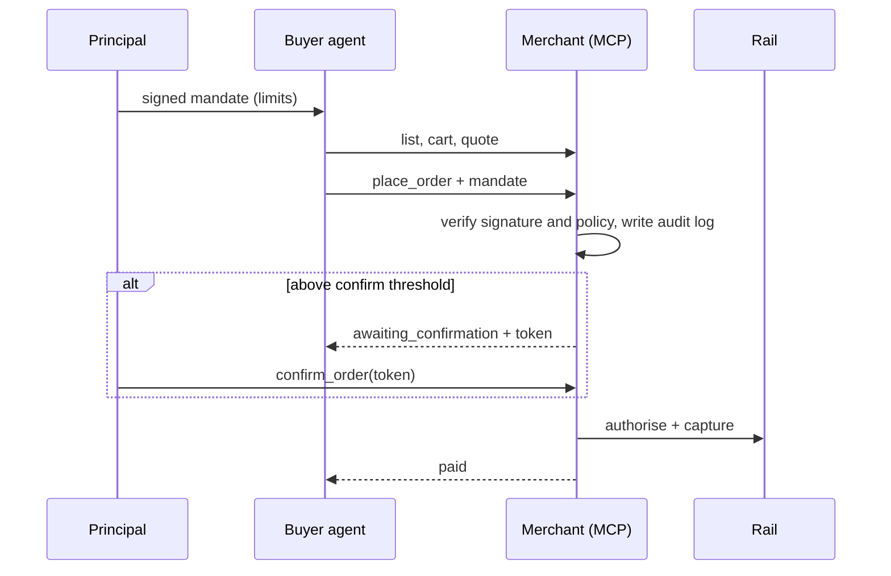

# PRD: agentic-checkout-reference

*v0.7, 28 Oct 2026. Author: Andrea Caputo.*

## 0. In plain words

An AI agent shops for you. You tell it: "buy up to £50 from this merchant, today only." The agent finds products, fills a cart and pays. This repo shows how that works safely: the merchant can check that the agent really has your permission, and that the purchase stays inside your limits. Above a threshold you set, the agent has to stop and ask you. Every check, pass or fail, is written down.

It runs end to end on a laptop, on synthetic data, with no real money. The point is to make the hard part visible: **authorisation, not the cart.**

## 1. Problem

Agents are starting to buy things. The cart is a solved problem. The unsolved one is delegation: how a human gives bounded spending authority to software, how a merchant verifies it without trusting the agent, and how a regulator sees a transaction the user never clicked (SCA under PSD2, with PSD3/PSR coming; the repo follows the README here and does not interpret the rules).

## 2. Goal and audience

- **Goal:** a public, runnable reference implementation of an agentic checkout, built from public specifications only.
- **Audience:** people evaluating agentic-commerce and payments product judgement: hiring managers, product and payments peers, engineers who clone it.
- **What a reader should believe after cloning:** the author understands the authorisation problem, made defensible design choices, and wrote down where they diverge from the standards.

## 3. Users and jobs

| User | Job to be done |
|---|---|
| **Principal** (the person delegating) | Set limits once, then not be asked again unless something exceeds them. |
| **Agent developer** | Call merchant tools with a mandate and get a clear, structured answer when refused. |
| **Merchant** | Verify the mandate before touching money, and refuse safely. |
| **Regulator or auditor** | See, after the fact, why each purchase was allowed or refused. |

## 4. Scope

| Stage | What exists |
|---|---|
| **1** | Merchant MCP server (catalogue, cart, quote, place_order, confirm_order), buyer agent, signed mandate with policy checks and audit log, stub payment rail, tests, CI, `npm run demo`. |
| **2** | Stripe test-mode rail behind the same interface; failure-case suite and replay protection. |
| **3** | Demo recording, design-decision write-up, protocol divergence notes. |

## 5. Requirements

**Mandate**

- R1. A mandate is a signed object: principal, agent, merchant, currency, total cap, per-transaction cap, validity window, human-confirm threshold. It is signed with Ed25519 over canonical JSON, and every field present is signed (ruled 27 Oct, P1 to P5; recorded in `docs/DECISIONS.md` as D22 to D26).
- R2. The merchant first checks two gates, a valid amount and a valid signature, and stops if either fails (D42). Every other check then runs and all failures are reported together, in this order: agent, merchant, window, currency, per-transaction cap, remaining budget. Currency comes before the caps because a cap in one currency says nothing about an amount in another (D43). If nothing failed and the amount is above the human-confirm threshold, the outcome is a confirmation request, not a refusal (D41, R4). Each failure returns a structured refusal reason.
- R3. Amounts are positive whole numbers of minor units. Zero, fractions and anything else are refused (D58).
- R4. Above the human-confirm threshold the order is held (`awaiting_confirmation`) for fifteen minutes, until a human confirms with a token. On confirmation the merchant checks again that the stock, the hold and the mandate (expiry, caps, remaining budget) still allow the order; if not, it refuses (D82, D83). A declined card ends the order and spends the token (D84).
- R5. Every mandate check and every payment outcome (paid, payment declined, capture failed, rail unavailable), pass or fail, is appended to one audit log. Entries are never edited. A refusal that never reaches the rail leaves no payment entry (D99), and a stock refusal at `place_order` leaves no entry at all (D65).

**Merchant**

- R6. An MCP server exposes `list_products`, `get_product`, `create_cart`, `add_to_cart`, `get_quote`, `place_order` and `confirm_order`. Carts are addressed by explicit id, because MCP 2026-07-28 is stateless (D11).
- R7. Stock is checked at order time but never reserved (D17).

**Agent and rails**

- R8. A buyer agent runs a deterministic scripted plan: list, pick two, cart, quote, place order with the mandate.
- R9. Payments go through a rail interface (`authorise`, `capture`). Stage 1 uses a deterministic stub that can also decline, fail a capture or be unavailable, so every failure path is testable (D50 to D57). Stage 2 uses Stripe PaymentIntents in test mode, with keys only in a local `.env`.

**Failure cases (Stage 2)**

- R10. Expired mandate, wrong merchant, over cap and replay are each rejected end to end through the server, and each appears in the audit log.

## 6. Non-goals and boundaries

**Non-goals.** Not a product: synthetic catalogue, no real money, no accounts. Not a conformance claim to ACP or AP2: they are referenced for shape and vocabulary. Not derived from any employer system.

**What a mandate bounds.** Which agent, which merchant, which currency, a total cap, a per-transaction cap, a validity window, and a point above which a human must confirm.

**What it does not bound (out of scope for Stage 1 and 2).**

- Cancelling a mandate before it expires: it ends only at `valid_until`.
- Limits by product category, quantity, order rate or geography.
- Cancelling or refunding an order: the rail interface has `authorise` and `capture` only.

## 7. Success criteria

- S1. `npm install && npm test && npm run demo` runs clean from a fresh clone.
- S2. The demo has two runs: one that completes, and one that trips the human-confirm step and shows the confirmation.
- S3. Every refusal in R2, R3, R4 and R10 has a test that fails without the check.
- S4. Every spec, package and URL cited is verified, or marked UNVERIFIED.

## 8. Standards position

- **MCP:** built on spec revision 2026-07-28 and TypeScript SDK v2 (D09). Sampling, Roots and Logging are deprecated in that revision, so the design does not use them. A TypeScript v2 client negotiates 2026-07-28 against the merchant's stdio entry point; a server mounted without `serveStdio` serves 2025-11-25 (verified by test, D75).
- **ACP:** merchant objects follow the ACP product-feed and checkout vocabulary where it fits (spec 2026-04-17). Each divergence is a PROPOSED decision.
- **AP2:** the closest concepts are its Checkout Mandate and Payment Mandate. The repo keeps a flat mandate for Stage 1 and documents the gap (D10); T10 adds a field-by-field mapping.

Sources and the dates they were read are in `SOURCES.md`.

## 9. Open questions and risks

- **Open:** how the human confirmation is delivered in a real product (the repo models a token only); nonce versus order-id for replay protection (T12).
- **Open:** mandate revocation. The repo relies on expiry. A revoked-id check in the policy step is the likely design; a candidate task for Stage 2. UNVERIFIED: how AP2 handles revocation.
- **Risk:** specs move. Mitigation: `SOURCES.md` records dates read, and claims are re-verified before they are cited.
- **Risk:** the repo is read as a conformance claim. Mitigation: the non-goals and divergence notes say plainly that it is not.

## 10. How the pieces fit

## 11. Glossary

- **Mandate:** your signed permission slip for the agent.
- **Minor units:** pence, not pounds (£25.00 is 2500).
- **MCP:** the protocol agents use to call a merchant's tools.
- **ACP and AP2:** two public specifications for agent-driven checkout and payment authorisation.
- **Rail:** the thing that moves money. Here, a stub, then Stripe test mode.
