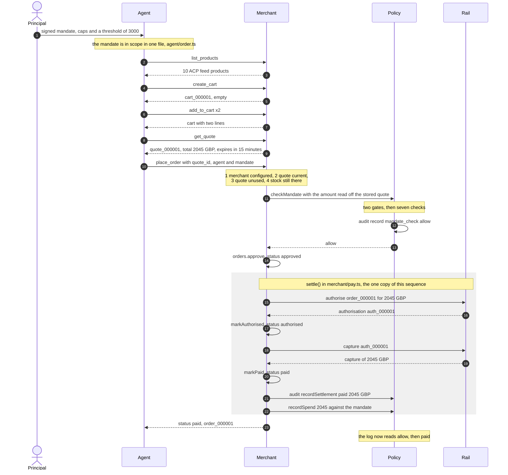
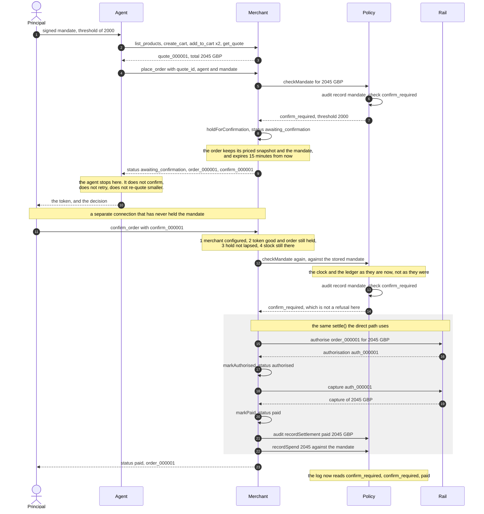

# SEQUENCE

The two paths `npm run demo` shows, as diagrams. Tool names, status words and
audit outcomes below are the ones the code actually uses — the diagrams were
drawn against `scripts/demo.ts`, `merchant/place-order.ts`,
`merchant/confirm-order.ts` and `merchant/pay.ts`, and checked against a real
run of `npm run demo`.

Five participants, matching the packages:

| In the diagram | Is | Lives in |
| --- | --- | --- |
| Principal | the person who signed the mandate | the demo plays this part: it issues both mandates and calls `confirm_order` in run 2 |
| Agent | the buyer agent | `agent/` |
| Merchant | the MCP server and its tools | `merchant/` |
| Policy | the mandate check, the spend ledger and the audit log | `mandate/` |
| Rail | the payment rail | `rail/` |

The audit log is reached as `policy.audit`, so every `audit` message below is
a call on the Policy participant (`merchant/tools.ts`, `MerchantState.policy`,
D69).

## 1. The direct path: the mandate covers the basket

Run 1 of the demo. The mandate's `human_confirm_above_minor` is 3000 and the
basket is 2045 pence, so nothing has to be asked and `place_order` pays inside
the one call (D88, D106, D116).

**What to notice.**

- The amount the mandate is checked against is read from the merchant's
  *stored* quote, never from the call (D39). The agent is the party the mandate
  exists to bound, so a price it hands back would be an input to distrust.
- The mandate check is **last** of the five, so the audit log records a
  decision the merchant actually acted on (D65). The cost is that the four
  checks above it leave no audit entry at all.
- `approved` is a state, not a body. The order passes through it inside the one
  call and the merchant never sends the word (D88, D80).
- The log is written **before** the ledger. Once the capture succeeded the
  money has moved, so the auditor's line is true from that instant (D98).
- Two audit entries for one purchase: one `mandate_check` with outcome `allow`,
  one `settlement` with outcome `paid`.

## 2. The held path: a human has to say yes

Run 2 of the demo. Same agent, same catalogue, same basket, same 2045 pence.
Two signed fields differ (`scripts/demo.ts`, `RUN_ONE` and `RUN_TWO`):
`human_confirm_above_minor` is 2000 rather than 3000, which is **the field
that decides the path**, and `mandate_id` is `2222…` rather than `1111…`,
which is a literal per run so the output stays reproducible (D103) and each
run's audit lines name their own authority. D106 says one field; the code says
two, and D116 records the correction.

**What to notice.**

- **The agent is given no way to confirm its own order** (D74). `runPlan` ends
  with `awaiting_confirmation` and hands the token back; `agent/` contains no
  call to `confirm_order` at all. The capability is absent rather than guarded,
  because an agent that *can* confirm is one mis-wired host away from doing so.
- **The confirmation arrives on a different connection.** In the demo the agent
  closes its client and the principal opens a second one over the same merchant
  state, because confirming down the agent's own channel would print the right
  words over the wrong wiring (D101).
- **The mandate is checked twice, and the second time is the one that matters**
  (D83). A human may take minutes, and in those minutes the mandate's window
  can close or another order can eat the budget. So the policy is re-run against
  the clock and the ledger as they are *now*. `confirm_required` is not treated
  as a refusal here — being above the threshold is the reason the token exists.
- **The quote is not re-read** (D82). The order carries its own priced
  snapshot, and that snapshot is what the human was asked about. A cart the
  agent touched afterwards cannot cancel a purchase a person already agreed to.
- Three audit entries for one purchase: two `mandate_check` entries, both
  `confirm_required`, and one `settlement` with outcome `paid`.
- The merchant holds the mandate in memory for the whole fifteen minutes. That
  is a real widening of what it keeps, and it is listed among the known limits
  in `docs/ARCHITECTURE.md` (D83).

## 3. What the demo does not show

Neither run shows a refusal or a failed payment (D106). The policy's third
answer and the rail's four outcomes are exercised in the tests
(`test/mandate/policy.test.ts`, `test/merchant/place-order.test.ts`,
`test/merchant/confirm-order.test.ts`, `test/merchant/settlement-audit.test.ts`)
rather than in the transcript, and the end-to-end refusal suite is Stage 2's
T12 (PRD R10).

For reference, the four ways `settle()` can end (`merchant/pay.ts`, D81, D85):

| Outcome | Order ends | Error code | Audit entry | Ledger |
| --- | --- | --- | --- | --- |
| captured | `paid` | — | `settlement` / `paid` | credited |
| `authorise` declined | `declined` | `payment_declined` | `settlement` / `payment_declined` | untouched |
| `capture` declined | stays `authorised` | `capture_failed` | `settlement` / `capture_failed` | untouched |
| rail threw | unchanged | `rail_unavailable` | `settlement` / `rail_unavailable` | untouched |

A refusal that never reaches the rail settles nothing and logs no settlement
(D99), and a `place_order` refused before the mandate check leaves no entry of
either kind (D65).
